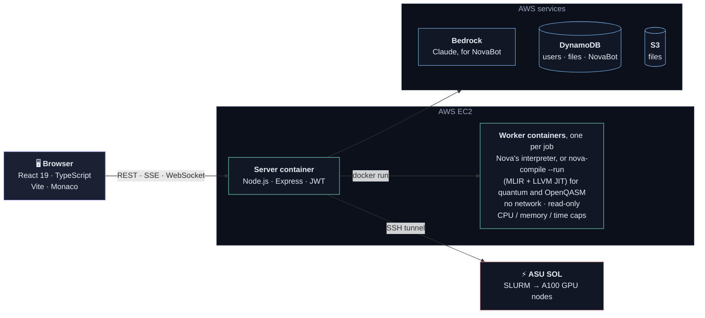
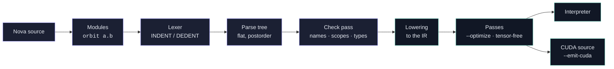
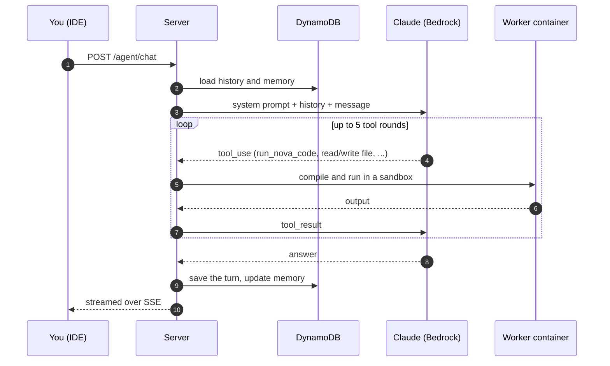
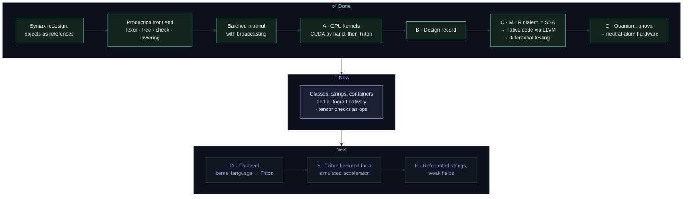

<div align="center">



[](https://github.com/parhitmtech/NovaQuantum/actions/workflows/ci.yml)


[](https://marketplace.visualstudio.com/items?itemName=parhitmathur.nova-quantum)
[](https://marketplace.visualstudio.com/items?itemName=parhitmathur.nova-programming-language)

**[Install](#-install)** · [Native code](#-nova-to-native-code-through-mlir-and-llvm) · [Quantum](#%EF%B8%8F-quantum-circuits-for-neutral-atom-hardware) ·
[Try it](#%EF%B8%8F-try-it) · [The Nova language](#-the-nova-language) · [Design: quantum](docs/QUANTUM.md) ·
[Technical report](docs/paper/novaquantum.tex) · [Roadmap](docs/ROADMAP.md)

</div>

**NovaQuantum** is an SSA-based compiler built from scratch in C++ on MLIR and LLVM. It compiles in two
directions:

- **Nova programs to native code.** Nova is a **compiled, statically typed language with Python's syntax**, built
  for machine learning. Every program is type-checked before it runs. It is compiled ahead of time: lowered to MLIR
  in SSA form (with a custom tensor dialect) and through LLVM to a native executable. In CI, every compiled program
  must behave exactly as Nova's interpreter does.
- **Quantum circuits to neutral-atom hardware.** Circuits are written in Nova (a `qubit` type, `qpu` gates, classical
  feedback through `if`) and compile to `qnova`, a second dialect where qubits are SSA values. Circuits are
  decomposed into the machine's native gates and optimized. They are routed by **moving atoms** and scheduled into
  the parallel layers the hardware runs. A statevector simulator checks every compiled circuit against the original.

Both run in the browser: the **NovaComp cloud IDE** sends quantum programs and OpenQASM circuits to
`nova-compile --run`, which compiles them through MLIR and LLVM in memory (LLVM's JIT) inside a locked-down
sandbox and shows the results with the circuit's gate counts and hardware timing.

It grows out of [Nova](https://github.com/parhitmtech/Nova), whose full history it carries: the language, its
interpreter, the CUDA and Triton matmul kernels, and the NovaComp cloud IDE are all here too.

> 📄 **Technical report:** [docs/paper/novaquantum.tex](docs/paper/novaquantum.tex): the design, the methodology,
> how each result is checked, and the measured results, in one paper (LaTeX; compiles as is on Overleaf).

## 📦 Install

Both compilers come as VS Code extensions, with everything inside (LLVM and MLIR included): nothing else to
install, on Linux (x64) and Windows (x64).

| Extension | For | Install |
|---|---|---|
| **Nova Quantum Compiler** | Quantum circuits in Nova or OpenQASM 3, compiled for neutral-atom hardware: each circuit's compiled cost above it, the circuit at each stage, Run on the simulator, OpenQASM export | [Marketplace](https://marketplace.visualstudio.com/items?itemName=parhitmathur.nova-quantum) · `code --install-extension parhitmathur.nova-quantum --pre-release` |
| **Nova Compiler** | The Nova language: errors as you type, quick fixes, hover, completion, Run, the REPL (installed with Nova Quantum Compiler) | [Marketplace](https://marketplace.visualstudio.com/items?itemName=parhitmathur.nova-programming-language) · [Open VSX](https://open-vsx.org/extension/parhitmathur/nova-programming-language) |

**[Getting started](docs/GETTING_STARTED.md)** goes from installing to a first program and
[a first quantum circuit](docs/GETTING_STARTED.md#7-a-first-quantum-program). To build the compilers from source,
see [Try it](#%EF%B8%8F-try-it).

## 🧩 Nova to native code, through MLIR and LLVM

```
prog.nova ─▶ front end ─▶ nova + scf + arith + func (SSA) ─▶ runtime calls ─▶ llvm dialect ─▶ LLVM IR ─▶ executable
             types,       ifs' results as phis, loops'        dialect           MLIR's own       clang -O2
             generics     variables as block arguments        conversion        conversions      + C runtime
```

- **SSA construction from a checked tree:**
  - each variable maps to the SSA value it holds;
  - `scf.if` results act as phis, and `scf.while` block arguments carry loop variables;
  - `break`, `continue` and `return` become flags, since structured regions have no jumps;
  - generic functions become one `func.func` per instantiation (monomorphization).
- **A tensor dialect in TableGen.** Each op declares per-value memory effects (`MemAlloc`, `MemRead`, `MemWrite`)
  and a `runtime_error` effect when it can fail, so upstream CSE, LICM and canonicalize optimize it without breaking
  observable behavior.
- **Dialect conversion to LLVM.** A type converter maps tensors to `!llvm.ptr` through signatures, calls and `scf`,
  with one pattern per op. `nova-compile` runs all of it in one process, so runtime errors cite the Nova source line.
- **Differential testing in CI.** Every program runs natively and interpreted, and stdout, stderr and exit status
  must match. All 28 programs that compile natively match. It found two real bugs:
  - the interpreter printed a tensor's handle instead of its elements;
  - integer division by zero was undefined behavior in LLVM. It is now an explicit check op, which canonicalize
    removes when the divisor is a nonzero constant.

| Benchmark | Interpreter | Nova native | Speedup | Same in C, clang -O2 |
|---|---|---|---|---|
| `calls` (naive fib(30), 1.3M calls) | 633 ms | 2.9 ms | **215×** | 2.5 ms |
| `int_loop` (3M iterations) | 159 ms | 1.0 ms | **157×** | 2.1 ms (64-bit ints) |
| `fibonacci` (fib(35)) | 53 ms | 26 ms | 2.1× | 34 ms |

Median of 7 runs, process start included (`compiler/mlir/utils/benchmark.py`). The interpreter memoizes pure
functions automatically, so for fib(35) it skips most of the 30M calls that native code makes.

## ⚛️ Quantum circuits for neutral-atom hardware

Circuits are written in Nova, with a `qubit` type and gates from the built-in `qpu` module, Python-library style:

```python
ignite:                                 # quantum teleportation: examples/quantum/teleport.nova
    qubit a = qpu.alloc()
    qubit b = qpu.alloc()
    qubit c = qpu.alloc()
    qpu.ry(a, 2.0943951023931953)       # the state to send: |1> with probability 0.75
    qpu.h(b)
    qpu.cx(b, c)                         # b and c entangled
    qpu.cx(a, b)
    qpu.h(a)
    bool m1 = qpu.measure(a)
    bool m2 = qpu.measure(b)
    if (m2):                             # classical feedback
        qpu.x(c)
    if (m1):
        qpu.z(c)
    qpu.probs(c)                         # |0>: 0.2500  |1>: 0.7500, whatever was measured
```

They compile to `qnova`, where each qubit is an SSA value. A gate in Nova changes its qubit variable; the compiler
turns that into a new SSA value, the same SSA construction it uses for ordinary variables. A loop carries a qubit as
a block argument, and an `if` carries it out as a result:

```mlir
%bit, %a1 = qnova.measure %a0
%c1 = scf.if %bit -> (!qnova.qubit) {   // the corrected qubit: a phi of the circuit's wire
  %x = qnova.x %c0
  scf.yield %x : !qnova.qubit
} else {
  scf.yield %c0 : !qnova.qubit
}
```

- **No-cloning, enforced twice.** The check pass rejects Nova code that would copy a quantum state: assigning a
  qubit, passing one to a function, or giving one gate the same qubit twice. In the IR, a `LinearQubits` trait
  verifies that each qubit value is consumed at most once on every path; an `if`'s two branches are two paths.
- **Native gates of a neutral-atom machine.** `--qnova-decompose` rewrites logical gates (`h`, `cx`, `cp`, `swap`, …)
  into Raman rotations (`r(θ, φ)`, `rz`) and the Rydberg `cz`.
- **Optimization on SSA def-use.** Self-inverse gates cancel, rotations merge, and diagonal gates commute through
  `cz`. Gates that are unobservable are dropped: diagonal gates on fresh qubits or before readout, and gates on
  qubits never measured (justified by the no-signaling theorem).
- **Hardware-aware scheduling.** Atoms are placed on a grid. Routing **moves atoms** with optical tweezers instead of
  inserting SWAP gates. Operations are packed into Raman, Rydberg and move layers, with parallel `cz` gates kept
  apart by the blockade radius.
- **Down to timed hardware instructions.** A third dialect, `atom`, is the machine's instruction stream: loads, Raman
  pulses and phase shifts on sites, tweezer moves, and *one global Rydberg pulse per layer*, each with its start and
  duration under a configurable timing model (`nova-compile --hardware`).
- **Checked on a simulator.** The runtime's statevector simulator runs each circuit as written and as compiled, and
  CI requires identical probabilities. It runs the hardware program too, by site. That check found a scheduler bug
  in which two atoms collided, invisible at the gate level
  ([QUANTUM.md](docs/QUANTUM.md#the-hardware-layer-timed-instructions-the-atom-dialect)).
- **OpenQASM 3 in and out, checked against Qiskit.** `nova-translate` exports a circuit to OpenQASM and imports one
  (`nova-compile` takes `.qasm` too). Qiskit's independent simulator agrees with Nova in **all 88 comparisons**:
  Nova's circuits exported as written and as compiled for the machine, and Qiskit's random circuits imported and
  run as written, as native gates and as hardware instructions
  ([BENCHMARKS.md](docs/BENCHMARKS.md#against-qiskit-through-openqasm)).
- **In the cloud IDE.** NovaComp runs quantum programs and OpenQASM circuits in its sandbox: the server sends them to
  `nova-compile --run`, which compiles them through MLIR and LLVM in memory with LLVM's JIT (no file written, no
  `clang` in the read-only sandbox) and runs them on the simulator, showing the compiled circuit's stats and hardware
  time. The worker smoke test in CI runs teleportation and an OpenQASM circuit through the real container.
- **On the GPU.** A CUDA statevector simulator (one coalesced kernel per gate) is a drop-in for the runtime
  (`nova-compile --gpu`). On an A100-80GB it matches the CPU to 10⁻¹⁷ and sustains **1.6 TB/s, 77–81% of peak
  memory bandwidth**, **256–529× faster** than one CPU core and 21–37× faster than 16 at 20–24 qubits; a 28-qubit
  circuit of 695 gates takes 3.1 s ([BENCHMARKS.md](docs/BENCHMARKS.md#the-statevector-simulator-on-a-gpu)).

| Circuit | Qubits | Native gates | Compiled | Saved | Moves | Layers | Gate time | Move time | = logical |
|---|---|---|---|---|---|---|---|---|---|
| GHZ | 12 | 57 | 45 | 21% | 7 | 26 | 10.9 µs | 80.0 µs | ✓ |
| QFT, then its inverse | 8 | 764 | 4 | **99%** | 0 | 1 | 1.0 µs | 0 | ✓ |
| random, 120 gates | 8 | 483 | 355 | **27%** | 26 | 244 | 109.5 µs | 725.2 µs | ✓ |
| random, 300 gates | 12 | 1026 | 867 | 15% | 72 | 496 | 219.3 µs | 1727.4 µs | ✓ |

Gate and move time are those of the hardware program (below), without the final readout: moves take 3–8× as
long as all the gates, so routing dominates run time on this machine model. "= logical" checks both the native
circuit and the hardware program.

The design, with the physics behind each rewrite, is in **[docs/QUANTUM.md](docs/QUANTUM.md)**.

## 🧑‍💻 Built to be used

A compiler is used through its error messages and its editor support, so both are part of the compiler, not
afterthoughts:

- **Errors with stable codes and exact ranges.** Every error and warning has a code (`E0502`) explained in
  [docs/ERRORS.md](docs/ERRORS.md), and points at the exact expression. After a syntax error the parser recovers at
  the next statement, so one run reports every mistake. Runtime errors show the failing expression and the calls
  that led to it.
- **A fuzzed front end.** libFuzzer runs the scanner, parser and type checker on arbitrary input under ASan and
  UBSan in CI; it found one crash (fixed), then ran 387,899 inputs clean in 10 minutes.
- **A language server on the compiler's own front end** (`nova-lsp`): the editor shows exactly the compiler's
  errors, about a millisecond per edit, with hover, go to definition, completion and quick fixes.
- **VS Code extensions** for Nova and Nova Quantum ([editors/vscode](editors/vscode)): Nova Quantum shows each
  circuit's compiled cost above it (native gates, depth, atom moves, time on the machine), runs it on the simulator,
  and shows the circuit at each stage of compilation. Both are tested in a real VS Code in CI.

## 🛠️ Try it

You need LLVM/MLIR 20 (with `clang-20`), CMake, Ninja and `lit`. On Ubuntu, install them from apt.llvm.org.

```bash
git clone https://github.com/parhitmtech/NovaQuantum.git && cd NovaQuantum
cmake -G Ninja -S compiler/mlir -B build/mlir -DMLIR_DIR=/usr/lib/llvm-20/lib/cmake/mlir \
      -DLLVM_EXTERNAL_LIT=$(command -v lit)
ninja -C build/mlir check-nova                                        # 45 lit tests

build/mlir/bin/nova-compile compiler/mlir/test/Run/tensors.nova -o t && ./t      # Nova to a native executable
build/mlir/bin/nova-compile compiler/mlir/test/Run/quantum.mlir --qnova-stats -o q && ./q   # a circuit
build/mlir/bin/nova-opt compiler/mlir/test/Run/quantum.mlir --qnova-to-native     # see the compiled circuit
build/mlir/bin/nova-compile examples/quantum/teleport.nova --run --qnova-stats    # JIT: compile in memory and run
build/mlir/bin/nova-compile examples/quantum/ghz.qasm --run --hardware --qnova-stats  # OpenQASM, timed

make -C compiler                                                      # the interpreter, for the checks below
python3 compiler/mlir/utils/difftest.py --build build/mlir --interpreter compiler/build/nova compiler/tests
python3 compiler/mlir/utils/qbench.py --build build/mlir              # the quantum table above
python3 compiler/mlir/utils/benchmark.py --build build/mlir --interpreter compiler/build/nova \
        compiler/benchmarks/compare/*.nova                            # the native-code table above
```

## 📜 The Nova language

**Nova** is a compiled, statically typed programming language for machine learning. It reads like Python, with
tensors, autograd and GPU-cluster training built into the language. **NovaComp** is the cloud IDE around it: a
browser editor that compiles and runs Nova in sandboxed containers, streams the output back, and includes an AI
coding assistant.

| | |
|---|---|
| **Syntax** | Python's layout: indentation, `def`, `class`, `if` / `elif` / `else`, `while`, `for`, `switch`. An `ignite:` block is the entry point. |
| **Types** | Static and checked before the program runs: `int`, `float`, `double`, `bool`, `string`, `Tensor`, structs, classes, `vector<T>`, `map<K, V>`. Type errors are compile errors. |
| **Functions** | Several return values (`int q, int r = divmod(17, 5)`). A function without parameter types is **generic**: compiled once per argument-type combination, as C++ templates are (monomorphization). |
| **Objects** | Structs, and classes with methods, constructors, inheritance and virtual dispatch; generic classes (`Box<T>`, one compiled copy per `T`). Objects are references, freed by reference counting when nothing refers to them. |
| **Tensors and ML** | 1–6-dimensional tensors with `+ - * / @`, indexing, slicing and broadcasting; reverse-mode autograd; `novatorch.nn` / `optim` / `data` in the standard library, via `orbit` modules. |
| **Ways to run** | Compiled to a native executable through MLIR and LLVM (`nova-compile`), or compiled in memory and run at once (`nova-compile --run`, LLVM's JIT); interpreted, with a REPL and a step debugger; in the browser IDE, sandboxed; CUDA source output; GPU training on a SLURM cluster (`sol.finetune`). |

How Nova's semantics differ from Python's, each difference checked against the interpreter: integer division,
32-bit `int`, block scoping, references, and type errors at compile time. See
[docs/PYTHON.md](docs/PYTHON.md).

> **Interactive showcase:** [`docs/showcase/index.html`](docs/showcase/index.html) is a single-file page with a
> live compiler walkthrough, a clickable architecture map and the benchmark charts.

```python
orbit novatorch.nn

def scale(x, k):                  # no types written: compiled once per argument-type combination
    return x * k

ignite:                           # the entry point
    Linear layer = Linear(2, 3)
    Tensor h = relu(layer.forward(randn(4, 2)))
    print(h.rows)                 # 4

    Tensor W = randn(3, 2)
    requires_grad(W)
    Tensor loss = mse_loss(ones(4, 3) @ W, zeros(4, 2))
    backward(loss)                # reverse-mode autograd
    print(tensor_grad(W).rows)    # 3

    print(scale(1.5, 2.0))        # 3.000000
```

## 💡 Why Nova

Python is the language of machine learning, but it's dynamically typed and slow, so the heavy lifting
happens in C++/CUDA libraries the language can't see into. Nova makes tensors a built-in type that the compiler
understands, which leaves room for what a library can't do: type-check tensor code before it runs, fuse
and compile tensor ops, and run the same program on a laptop or a GPU cluster.

<table>
<tr>
<td width="33%" valign="top">

**🧮 Tensors in the language**<br>
1–6-dimensional tensors with `+ - * / @`, indexing, slicing and broadcasting, checked by the compiler
before the program runs.

</td>
<td width="33%" valign="top">

**🔁 Autograd built in**<br>
`requires_grad`, `backward` and `tensor_grad`, with `novatorch.nn` / `optim` / `data` in the
standard library.

</td>
<td width="33%" valign="top">

**☁️ One path to the GPU**<br>
Write in the browser, run in a sandbox, train on ASU's SOL A100s with `sol.finetune(...)`.

</td>
</tr>
</table>

## 🧰 What's in the box

| Part | What it does |
|---|---|
| **Language** | Indentation-based syntax; static types (`int`, `float`, `double`, `bool`, `string`, `Tensor`); functions with several return values; generic functions and classes; structs, classes and inheritance; `vector<T>` and `map<K, V>`; modules via `orbit` |
| **Tensors and ML** | 1–6-dimensional tensors with `+ - * / @`, indexing and slicing, activations, losses, reverse-mode autograd, and `novatorch.nn` / `optim` / `data` in the standard library |
| **Compiler** | C++17; a lexer, a flat parse tree, a check pass for names and types, and lowering to an IR; optional optimizations (constant folding, copy propagation, dead-code elimination, loop-invariant code motion, inlining); a compiler pass that frees each tensor after its last use; an interpreter, and CUDA source output |
| **MLIR back end** | The `nova` dialect (TableGen ODS, per-value memory effects), SSA lowering from the checked tree (`scf`, `func`, `arith`), dialect conversion through `llvm` to native executables (`nova-compile`), a C runtime, and differential testing against the interpreter: [docs/DESIGN.md](docs/DESIGN.md), step C |
| **Quantum** | Circuits written in Nova (`qubit`, `qpu.*`); the `qnova` dialect: qubits as SSA values, decomposition into neutral-atom native gates, canonicalization, routing by moving atoms, layer scheduling; the `atom` dialect of timed hardware instructions; and a statevector simulator that checks every level: [docs/QUANTUM.md](docs/QUANTUM.md) |
| **GPU kernels** | Matmul and batched matmul in CUDA, by hand in four steps up to `cp.async` double buffering (82% of cuBLAS on an A100), and the same in Triton (95% of cuBLAS in FP32, up to 100% with tensor cores), with Triton's IR traced stage by stage: [compiler/kernels](compiler/kernels/) |
| **IDE** | React + Monaco editor, file workspace, terminal, REPL, step debugger, sharing, and NovaBot (Claude via AWS Bedrock), which can read, write and run code |
| **Execution** | Each run gets its own network-less, read-only container with CPU, memory, time and process limits |
| **GPU training** | `sol.finetune(...)` submits HuggingFace training jobs to ASU's SOL cluster over SLURM |

## 🚀 Quick start

You need `make`, a C++17 compiler (g++ or clang++) and Node.js 22.12+.

```bash
git clone https://github.com/parhitmtech/NovaQuantum.git && cd NovaQuantum
make -C compiler                      # builds compiler/build/nova
make -C compiler test                 # the golden language tests
make -C compiler lsp                  # builds compiler/build/nova-lsp, the language server editors run

export NOVA_HOME=$PWD/compiler        # where `orbit` finds the standard library
compiler/build/nova examples/xor.nova # trains a 2-layer network on XOR
```

<details>
<summary><b>Compiler flags</b></summary>

| Flag | Does |
|---|---|
| `--check` | Check the file without running it: every error, and the warnings |
| `--warnings` | Report warnings when running too |
| `--diagnostics=json` | Errors and warnings as one JSON document, for tools ([format](docs/ERRORS.md#the-json-format)) |
| `--error-limit=N` | Stop after N errors (default 20; 0: no limit) |
| `--color=auto\|always\|never` | Colors in error messages (`auto`: in a terminal, unless `NO_COLOR` is set) |
| `--optimize` | Constant folding, copy propagation, dead-code elimination, LICM, inlining |
| `--dump-tree` | Print the parse tree |
| `--dump-ir` | Print the IR |
| `--debug` | Step debugger |
| `--repl` | Interactive session |
| `--emit-cuda` | Write CUDA source |

</details>

To run the whole IDE locally (backend, frontend, Docker workers), follow [docs/SETUP.md](docs/SETUP.md).

## 🏗️ Architecture



The server and worker images are built from the same commit by CI, pushed to GHCR, and run on the EC2 host
with Docker Compose. [docs/ARCHITECTURE.md](docs/ARCHITECTURE.md) has the full picture.

<details>
<summary><b>The compiler pipeline</b></summary>



Generic functions and classes are checked once per copy; the tensor-free pass frees each tensor after its
last use; pure recursive functions are memoized automatically.

</details>

<details>
<summary><b>How NovaBot works</b></summary>



</details>

## 🛡️ Sandboxed execution

Every run gets its own container, and the deadline is enforced inside it, so a job stops even if the
server dies.

| Limit | Value |
|---|---|
| Network | none (`--network=none`) |
| Filesystem | read-only, all capabilities dropped, `no-new-privileges` |
| CPU / memory / processes | 1 CPU · 256 MB · 32 PIDs |
| Concurrency | 5 batch slots, at most 2 per user (REPL: a separate pool of 2) |

## ⚖️ How Nova compares

| | Nova | Python + PyTorch | JAX | Mojo | Julia |
|---|---|---|---|---|---|
| Typing | Static, checked before running | Dynamic | Dynamic (traced) | Static where declared | Dynamic, inferred |
| Tensors | Built-in type | Library | Library | Library | Library (arrays built in) |
| Autodiff | Built in | Library (autograd) | Library (`grad`) | Library | Library (Zygote, Enzyme) |
| Execution | Interpreter (LLVM and IREE planned) | Interpreter + C++/CUDA kernels | XLA compiler | MLIR → native | LLVM JIT |
| Comes with an IDE, sandbox and GPU cluster | ✅ | ❌ | ❌ | ❌ | ❌ |

Nova's lead is integration: one language, editor, sandbox and GPU path. It's a young, single-backend
language and doesn't compete on ecosystem or raw speed yet. [docs/COMPARISON.md](docs/COMPARISON.md) covers
where it fits and which ideas from these projects it should borrow.

## 📊 Performance

> **Native code:** compiled through MLIR and LLVM, the same programs run 2–215× faster than the interpreter below
> and on par with C. Measured on the machine in the [table at the top](#-nova-to-native-code-through-mlir-and-llvm),
> with the method in [BENCHMARKS.md](docs/BENCHMARKS.md#native-code-through-mlir-and-llvm). The charts below are
> the interpreter.

### CPU (interpreter)


Like-for-like programs that print the same result in every language; best of 7 runs including process
startup, on an Intel Core Ultra 7 155H (Windows 11). Nova's interpreter is 2–3.5× faster than CPython on
loops and vectors, but about 7.5× slower on function calls. ⚠️ `int_loop` gives the wrong answer because
Nova's `int` is 32-bit and overflows silently.

<details>
<summary><b>The numbers, and how to reproduce them</b></summary>

| Benchmark | Nova | CPython 3.13 | Node 22 | C (gcc -O2) |
|---|---|---|---|---|
| `calls`: naive `fib(30)`, 2.7M calls | 1,004 ms | 134 ms | 56 ms | 17 ms |
| `int_loop`: 3M-iteration arithmetic loop | 134 ms ⚠️ | 486 ms | 54 ms | 17 ms |
| `vector_sum`: fill and sum 1M-element vector | 93 ms | 192 ms | 64 ms | 17 ms |

```bash
python3 compiler/benchmarks/compare/run.py --optimize
```

[docs/BENCHMARKS.md](docs/BENCHMARKS.md) has the method, caveats such as automatic memoization, and the issues
the benchmarks found.

</details>

### GPU matmul


<details>
<summary><b>The numbers</b></summary>

On SOL's NVIDIA A100, share of cuBLAS's speed (all results match cuBLAS):

| Case | Best hand-written CUDA kernel | Triton FP32 | Triton TF32 (tensor cores) |
|---|---|---|---|
| 4096 x 4096 x 4096 | 82% | 95% | 84% (111 TFLOP/s) |
| 64 batched 256³ products | 77% | 112% | 98% |
| 1024 x 1024 x 1024 | 48% | 82% | 90% |

The kernels, what limits each step, and how to run them on SOL are in
[compiler/kernels/README.md](compiler/kernels/README.md).

</details>

## 🗺️ Roadmap



**Done:** the syntax redesign and objects as references, with reference counting; a production front end (a
new lexer, a flat parse tree, a separate check pass, and lowering to the IR); batched matmul with NumPy-style
broadcasting, forward and backward; GPU matmul kernels in CUDA and Triton, measured on A100s; a
[design record](docs/DESIGN.md) of the decisions. Also done:
- **C:** Nova as an MLIR dialect in SSA form, compiled through LLVM to native code and checked against the
  interpreter by differential testing in CI;
- **Q:** the `qnova` dialect, which compiles quantum circuits for a neutral-atom machine and checks them on a
  simulator.

**Now:** widening the native path to classes, strings, containers and autograd (28 test and benchmark programs
compile natively today, [BENCHMARKS.md](docs/BENCHMARKS.md#differential-testing)), and splitting the tensor ops'
runtime checks into ops a pass can prove away.

**Next:**
- a tile-level kernel language lowered to Triton;
- a Triton backend for a simulated AI accelerator;
- for `qnova`: Nova syntax for circuits and a richer machine model.

The full plan is in [docs/ROADMAP.md](docs/ROADMAP.md).

<details>
<summary><b>Known gaps today</b></summary>

- `int` is 32-bit and overflows silently ([BENCHMARKS.md](docs/BENCHMARKS.md#issues-found), issue 2). The native
  path wraps exactly as the interpreter does.
- Some of [docs/SYNTAX.md](docs/SYNTAX.md) is still the *target* design. Not yet implemented: `10_000` literals,
  `t.grad`, and `\n` / `\t` escapes.
- Natively compiled programs don't free their tensors yet, and `nova-compile` doesn't resolve `orbit` imports yet.

</details>

## 📚 Documentation

| Doc | For |
|---|---|
| [docs/GETTING_STARTED.md](docs/GETTING_STARTED.md) | Installing the VS Code extensions, a first program, its errors, the REPL, a first quantum circuit |
| [docs/QUANTUM.md](docs/QUANTUM.md) | Compiling quantum circuits for a neutral-atom machine: the qnova dialect, its passes, the physics behind each rewrite |
| [docs/SYNTAX.md](docs/SYNTAX.md) | The Nova language |
| [docs/PYTHON.md](docs/PYTHON.md) | How Nova's semantics differ from Python's, and how its interpreter differs from CPython |
| [docs/ARCHITECTURE.md](docs/ARCHITECTURE.md) | How the IDE, backend, sandbox, NovaBot, SOL and compiler fit together |
| [docs/SETUP.md](docs/SETUP.md) | Running and testing everything locally |
| [docs/DEPLOY.md](docs/DEPLOY.md) | Production deployment on EC2 |
| [docs/ROADMAP.md](docs/ROADMAP.md) | What comes next |
| [docs/DESIGN.md](docs/DESIGN.md) | The compiler's design decisions, with the alternatives and trade-offs (C: the MLIR back end) |
| [compiler/kernels/README.md](compiler/kernels/README.md) | The GPU matmul kernels and their A100 results |
| [compiler/kernels/triton/IR_WALKTHROUGH.md](compiler/kernels/triton/IR_WALKTHROUGH.md) | Triton's compilation of the matmul, stage by stage |
| [docs/BENCHMARKS.md](docs/BENCHMARKS.md) | Performance numbers, method, and the issues they found |
| [docs/COMPARISON.md](docs/COMPARISON.md) | Nova next to Python/PyTorch, JAX, Mojo, Julia and others |
| [docs/paper/novaquantum.tex](docs/paper/novaquantum.tex) | The technical report: design, methodology, procedure and results |
| [docs/GRAMMAR.md](docs/GRAMMAR.md) | The complete grammar of Nova, in EBNF: tokens, layout, statements, expressions |
| [docs/ERRORS.md](docs/ERRORS.md) | Every error and warning, by code, with how to fix it |
| [docs/RELEASING.md](docs/RELEASING.md) | Publishing the VS Code extension to the Marketplace and Open VSX |

## 📁 Repository layout

```
compiler/    the Nova language: C++17 compiler, runtime, stdlib, tests, benchmarks, GPU kernels (kernels/)
  mlir/      the MLIR back end: the nova, qnova and atom dialects (include/, lib/), nova-lower, nova-opt and
             nova-compile (tools/), the C runtime and quantum simulator (runtime/), lit tests (test/), and
             difftest.py, benchmark.py and qbench.py (utils/)
  lsp/       nova-lsp, the language server editors run (server.cc, analysis.cc), and its protocol tests
server/      Node.js + Express backend: auth, execution, workspace, NovaBot
frontend/    React + Vite IDE
examples/    Nova example programs
docs/        the documents above; docs/assets holds the README's graphics
editors/     the VS Code extensions: Nova Compiler (vscode/nova), Nova Quantum Compiler (vscode/nova-quantum)
deploy/      Docker Compose and deploy script for the EC2 host
tools/       SOL tunnel scripts, syntax migration scripts, the README graphics generator
```

## 🤝 Contributing

Every pull request runs the 8 required CI checks in [.github/workflows/ci.yml](.github/workflows/ci.yml).
Before you push, run the language tests with and without the optimizer:

```bash
make -C compiler test
NOVA_TEST_ARGS=--optimize make -C compiler test
```

A language change ships with a golden test in `compiler/tests/` (`name.nova` plus `name.expected`, or
`name.error` for a compile error) and an update to [docs/SYNTAX.md](docs/SYNTAX.md).

When benchmark numbers change, update them in `tools/readme/make_assets.py` and run
`python3 tools/readme/make_assets.py docs/assets` to redraw the charts.

## 📄 License

NovaQuantum is licensed under the [Apache License 2.0](LICENSE). To report a security issue, see
[SECURITY.md](SECURITY.md).
